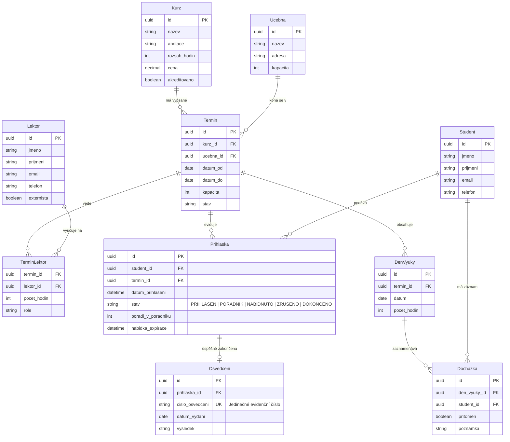

# Akademie Trutnov – Správa a evidence kurzů (Zadání C)

Semestrální projekt do předmětu **Pokročilé programování (PPRO)**, zimní semestr 2026/2027, Fakulta informatiky a managementu, Univerzita Hradec Králové (FIM UHK).

> **Jediný zdroj pravdy (Single Source of Truth):**  
> Tento dokument slouží jako kompletní zadání, technická dokumentace a evidence architektonických i doménových rozhodnutí projektu. Jakékoliv změny v návrhu, datovém modelu či business pravidlech se vždy neprodleně zaznamenávají zde.

---

## 1. Zadání klienta

### Klient a kontext
- **Klient:** Ing. Lucie Bartošová, Akademie Trutnov
- **Činnost:** Poskytování rekvalifikačních a firemních kurzů (~40 běhů ročně).
- **Lektoři:** Externí odborníci.

### Jak to mají dnes (Současný stav)
- Přihlášky přicházejí přes webový formulář do e-mailu a ručně se přepisují do tabulkového procesoru (jedna záložka pro každý kurz).
- Kapacity učeben a termínů se hlídají pouze vizuální kontrolou tabulky.
- Pořadník náhradníků se vede jako tužkou psaná poznámka pod seznamem.
- Osvědčení se ručně vypisují v textovém editoru (Word), evidenční čísla se generují odhadem podle počtu vydaných v daném roce (již došlo k duplicitnímu přidělení stejného čísla).
- Kritická slabina: Pokud někdo na poslední chvíli účast odřekne, vedení centra složitě dohledává kontakty na náhradníky a kapacity zůstávají neobsazené.

### Co klient chce (Funkční požadavky)
1. **Kurzy:** Evidence kurzů (název, anotace, rozsah v hodinách, cena, příznak akreditace MŠMT).
2. **Termíny kurzu:** Možnost opakování kurzu v roce. Každý termín má datum od–do, přiřazené místo konání (učebnu) a kapacitu (kapacita kurzu se odvíjí od konkrétní učebny).
3. **Lektoři a jejich přiřazení k termínům:** Jeden lektor může vést více termínů, u vícedenních či delších kurzů se na jednom termínu střídají dva i více lektorů.
4. **Přihlášky studentů na termín:** Jeden student se může účastnit více kurzů, na jednom termínu je více studentů (vazba M:N).
5. **Kapacita a pořadník:** Při naplnění kapacity termínu je další zájemce zařazen do pořadníku náhradníků se zachováním pořadí. Při uvolnění místa je zřejmé, kdo je na řadě.
6. **Docházka:** U vícedenních kurzů evidence denní docházky (kdo byl který den přítomen).
7. **Dokončení a osvědčení:** Po skončení termínu vygenerování seznamu úspěšných absolventů a vystavení osvědčení s jedinečným evidenčním číslem a datem vydání.
8. **Přehledy a reporty:**
   - Vytíženost a naplněnost termínů.
   - Počet reálně odučených hodin jednotlivých lektorů.
   - Seznam studentů, kteří se v daném roce přihlásili na více než jeden kurz.

### Na čem klient trvá (Nepřekročitelná obchodní pravidla)
- **Kapacitu termínu nelze překročit** (žádné ruční přepisování limitu nad kapacitu učebny).
- **Pořadí v pořadníku se nesmí přeskakovat.**
- **Číslo osvědčení je striktně jedinečné** a jednou vydané osvědčení je neměnné (historický audit).
- **Zrušená přihláška zůstává v systému dohledatelná** (z důvodu řešení reklamací a sporů o přihlášení).

### Co klient prohodil mimochodem (Budoucí rozšíření)
- Fakturace a platební brána (zatím neřešit v MVP, ale počítat s budoucím napojením).
- Jednoduché, přehledné UI vhodné i pro méně technicky zdatné externí lektory.
- Automatické e-mailové notifikace (potvrzení přihlášky, výzva pro náhradníka).
- Příprava dat pro export do ministerských výkazů.

---

## 2. Oddíl: Rozhodnutí k otevřeným bodům

Podle pokynů k semestrálnímu projektu je zde jednoznačně zdokumentováno řešení všech nejasností a otevřených bodů klienta:

| # | Otevřený bod klienta | Přijaté rozhodnutí a jeho zdůvodnění |
|---|---|---|
| **1** | **Kdo rozhoduje o dokončení kurzu** *(70% docházka vs. posouzení lektorem)* | **Dvoustupňové ověření:** Systém vyžaduje splnění minimální docházky $\ge 70\ \%$ jako technickou prerekvizitu (podmínku nutnou pro akreditaci). Finální potvrzení úspěšného absolvování („Prospěl“ / „Neprospěl“) provádí lektor v rozhraní termínu na základě hodnocení praktických dovedností a testu. Tím jsou splněny formální požadavky akreditace i odborný úsudek lektora. |
| **2** | **Automatický posun z pořadníku** *(automatický zápis vs. manuální potvrzení)* | **Automatická nabídka s časovým limitem (Hold/Offer):** Při uvolnění kapacity systém automaticky nabídne místo prvnímu náhradníkovi v pořadníku a přepne jeho přihlášku do stavu `NABÍDNUTO` s lhůtou na potvrzení (24 hodin). Pokud zájemce potvrdí, stav přejde na `PŘIHLÁŠEN`. Pokud odmítne nebo lhůta vyprší, přihláška získá stav `EXPIROVÁNO` a systém osloví dalšího v pořadí. Pořadí se nikdy nepřeskakuje. |
| **3** | **Dva termíny téhož kurzu naráz** *(možnost vícenásobného zápisu)* | **Zákaz souběžného přihlášení na aktivní termíny téhož kurzu:** Jeden student může mít v jednom čase pouze jednu aktivní přihlášku na tentýž kurz, aby se zamezilo spekulativnímu blokování kapacit. Přihláška na nový termín stejného kurzu je možná až po řádném dokončení (nebo neúspěchu) či zrušení předchozí přihlášky. |
| **4** | **Přihlášení po zahájení kurzu** *(„nejde to, leda po domluvě“)* | **Systémový uzávěr s výjimkou administrátora:** Veřejné přihlašování se automaticky uzamyká v okamžiku data zahájení termínu. Dodatečné přihlášení může zadat pouze administrátor/recepce s povinným textovým odůvodněním, a to výhradně do doby, než proběhne 20 % hodinové dotace kurzu, aby student mohl reálně splnit podmínku 70% docházky. |
| **5** | **Jeden lektor, nebo víc / vykazování hodin** *(střídání vs. hodiny na termín)* | **Vazba M:N s rozpisem na dny a přímou evidencí hodin:** Termín může mít více přiřazených lektorů s rozpadem na konkrétní dny výuky (`TerminLektor`). V přehledech a mzdových podkladech se lektorům vykazují reálně odučené hodiny z jejich rozvrhových bloků, nikoliv paušální délka celého termínu. |

---

## 3. Technická architektura (Povinné minimum)

Aplikace striktně dodržuje požadavky semestrálního projektu PPRO:
- **Třívrstvá architektura se závislostmi jedním směrem:**
  1. **Prezentační vrstva:** REST API / Webové rozhraní (Controller / UI).
  2. **Aplikační / Byznys vrstva:** Služby, doménové invarianty (kontrola kapacit, pořadník, validace docházky, generátor číselné řady osvědčení).
  3. **Datová / Infrastrukturní vrstva:** Relační databáze, migrace schématu, repozitáře / ORM.
- **Relační databáze v Dockeru s migracemi:** Verzované skripty pro strukturu databáze a počáteční seed syntetických dat.
- **Kontejnerizace:** Spuštění celého prostředí jediným příkazem:
  ```bash
  docker compose up --build
  ```
- **Testy:** Sada automatizovaných integračních a jednotkových testů ověřujících nepřekročitelnost kapacity, pořadník a výpočet docházky.
- **Bezpečnost dat:** Všechna data v databázi a testech jsou výhradně **syntetická**. V repozitáři nejsou žádná hesla ani reálné osobní údaje.

---

## 4. Datový model (Entity a vazby)

Systém pokrývá minimálně 7 klíčových entit s vazbami 1:N i M:N:



---

## 5. Spuštění projektu

Projekt se spouští v kontejnerizovaném prostředí:

```bash
# 1. Klonování repozitáře (pokud ještě nemáte naklonováno)
git clone https://github.com/8ight1ne/ppro2026.git
cd ppro2026

# 2. Sestavení a spuštění kontejnerů včetně migrací a seedu dat
docker compose up --build
```

---

## 6. Historie a Changelog

| Datum | Změna | Autor |
|---|---|---|
| 2026-09-30 | Inicializace repozitáře, nastavení pravidel asistenta v `AGENTS.md`, vytvoření technické dokumentace a oddílu Rozhodnutí v `README.md`. | Vývojový tým |
